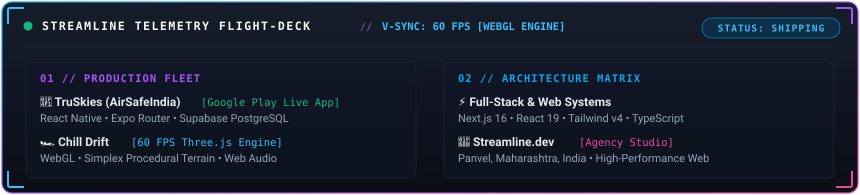

  <h1>Hi, I'm Akshay Gaikwad 👋</h1>
  
    
  

    📍 <b>Panvel, Maharashtra, India</b> &nbsp;•&nbsp;
    🚀 Founder & Lead Engineer at <b><a href="https://github.com/Streamline-dev0">Streamline.dev</a></b> &nbsp;•&nbsp;
    🌐 <a href="https://stream-line.dev/"><b>stream-line.dev</b></a>
  

  

    &nbsp;
    &nbsp;
    &nbsp;
    
  

 

<!-- ========================================== -->
<!-- 🚀 3D WEBGL & SYSTEMS TELEMETRY FLIGHT-DECK -->
<!-- ========================================== -->

  

 

---

### 🚀 Flagship & Production Showcases

| Project | Domain | Architecture & Stack | Live Delivery | Source |
| :--- | :--- | :--- | :--- | :--- |
| 📱 **TruSkies (AirSafeIndia)** | Mobile Aviation & Admin | `React Native` `Expo Router` `Supabase` `PostgreSQL` |  | *Client Confidential* |
| 🏎️ **Chill Drift** | 3D WebGL Racing Game | `Three.js` `WebGL` `Vite` `Simplex Noise` `Audio API` |  |  |
| ⚡ **Streamline.dev** | 3D Creative Agency (60 FPS) | `Next.js 16` `React Three Fiber` `Tailwind CSS` `GLSL` |  | *Production* |
| 🏛️ **PHCET Research Lab** | Institutional Portal | `Next.js` `TypeScript` `Tailwind CSS` `Supabase` |  | *Internal* |
| 🛒 **Sakshat Store** | E-Commerce Platform | `Next.js (SSR)` `TypeScript` `Tailwind CSS` `Stripe` |  | *Client Delivery* |
| 🌐 **Disha Enterprises** | 3D WebGL Corporate Landing | `React.js` `Three.js` `WebGL` `Tailwind CSS` |  | *Client Delivery* |

---

### 🛠️ Open-Source Systems & Interactive Demonstrations

| Demonstration System | Specialization | Modern Tech Stack | Live Demo | Repository |
| :--- | :--- | :--- | :--- | :--- |
| 💳 **Credit Repair** | Financial Services Platform Demo | `React 19` `Vite 7` `GSAP` `Lenis` `Tailwind v4` |  |  |
| 🏢 **Boliwala** | Real-Estate Auction Demo | `Next.js 16` `React 19` `Tailwind v4` `Lenis` |  |  |
| ⚡ **DataAPI Live** | Web Extraction & Analytics Demo | `Next.js 16` `React 19` `Framer Motion` `Tailwind v4` |  |  |
| 🏥 **Dental Care Pro** | Clinical Operations & Patient Management | `Next.js 14` `PostgreSQL` `Tailwind CSS` `Lucide` | *Clinical DB Architecture* |  |
| 📱 **Viraj Telecom** | Electronics & Hardware Service Demo | `Next.js 16` `React 19` `Tailwind v4` `Lucide Icons` |  |  |
| 🎨 **Graphics Portfolio** | Industrial Graphics & Signage Demo | `Next.js 16` `React 19` `Tailwind v4` `OpenGraph` |  |  |
| 🏭 **Prajapati Steel** | Industrial Metals Manufacturing Demo | `Next.js 16` `React 19` `Tailwind v4` `Responsive UI` |  |  |
| 🤖 **AILMS** | AI Learning Platform (Microservices) | `React 19` `Express API` `FastAPI` `MongoDB` `Python` | *Microservices Setup* |  |

---

### 🛠️ Technical Arsenal

| Domain | Stack & Tooling |
| :--- | :--- |
| **Languages** |       |
| **Frontend & 3D Web** |        |
| **Mobile Engineering** |     |
| **Backend & Cloud** |       |
| **DevOps & Infrastructure** |      |

---

<!-- ========================================== -->
<!-- 📊 SELF-HOSTED CONTRIBUTION SPECTRUM MATRIX -->
<!-- ========================================== -->

  

---

  

    <b>Let's build something extraordinary together.</b> 
    💼 Available for High-Impact Roles, Architectural Consulting & Client Engineering. 
    📫 Connect via <a href="mailto:akshaygaikwad2203@gmail.com"><b>akshaygaikwad2203@gmail.com</b></a> or <a href="https://www.linkedin.com/in/akshayjgaikwad/"><b>LinkedIn</b></a>.
  

  Engineered by Akshay Gaikwad • Founder @ <a href="https://github.com/Streamline-dev0">Streamline.dev</a>

